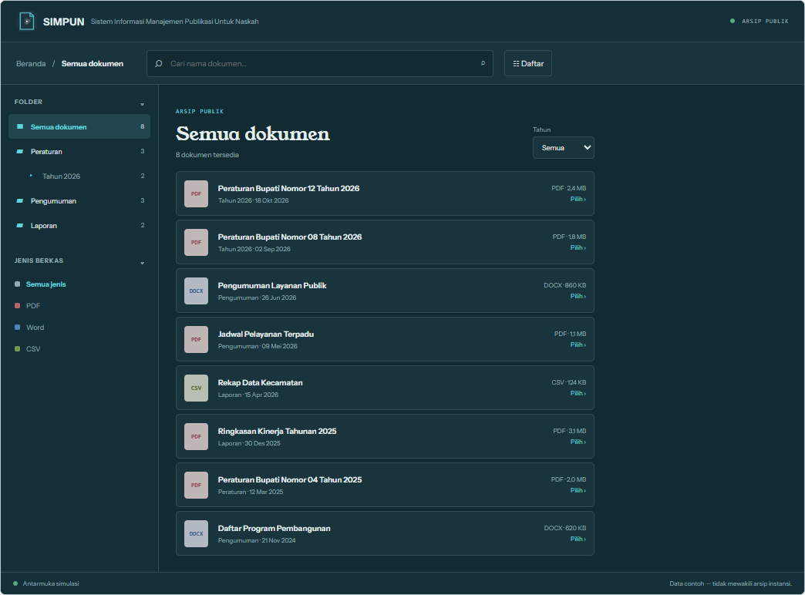
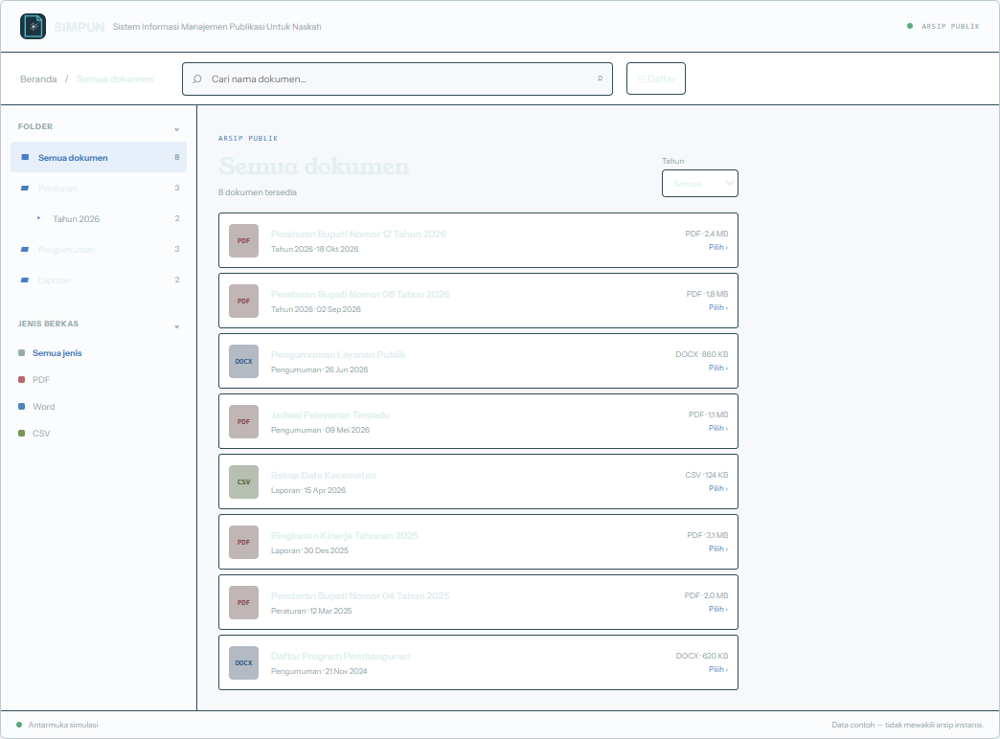
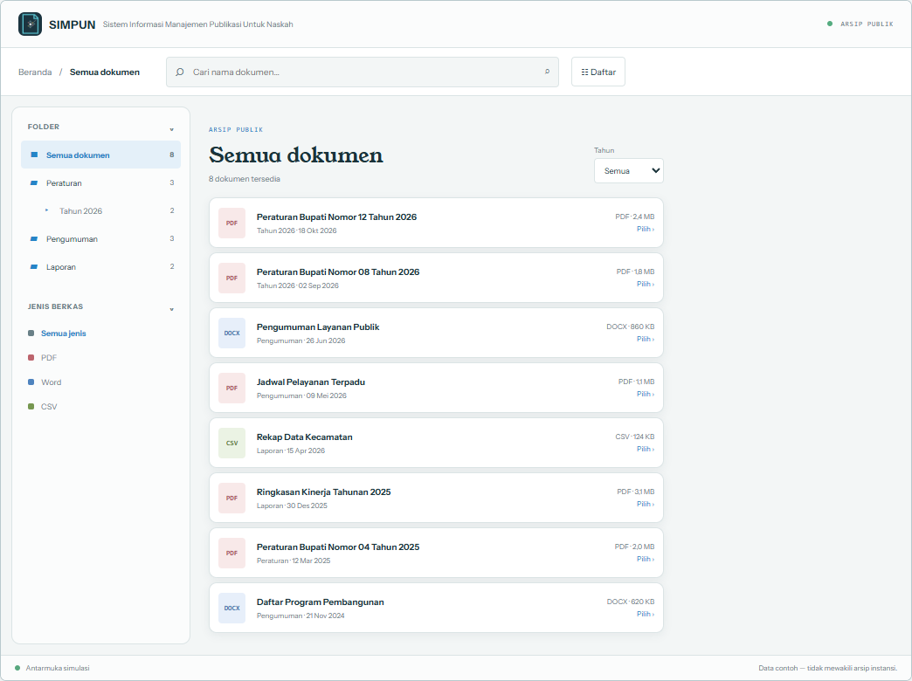

<div align="center">
  <a href="logo.png"></a>

  <h1>SIMPUN</h1>

  <h3>Sistem Informasi Manajemen Publikasi Untuk Naskah</h3>

  <p>Portal publikasi dokumen yang ringan, responsif, dan mudah dikelola—tanpa database.</p>

  <p>
    <a href="https://github.com/LodriX/Publikasi-doc/stargazers"></a>
    <a href="https://www.php.net/releases/8.1/en.php"></a>
    
    <a href="https://github.com/LodriX/Publikasi-doc"></a>
  </p>

  <p>
    <a href="#mulai-cepat">Mulai cepat</a> ·
    <a href="#pasang-di-hosting-dari-awal">Panduan hosting</a> ·
    <a href="DESIGN.md">Sistem desain</a> ·
    <a href="https://github.com/LodriX/Publikasi-doc/issues">Laporkan masalah</a>
  </p>
</div>

---

## Sekilas

SIMPUN membantu instansi mempublikasikan arsip dokumen dengan rapi dan membuatnya mudah ditemukan publik. Pengunjung dapat menjelajahi folder, mencari dan menyaring berkas, melihat pratinjau, lalu menyalin tautan atau mengunduh dokumen. Administrator mengelola publikasi melalui dashboard sederhana.

Metadata disimpan sebagai berkas di `data/`, sedangkan dokumen berada di `Files/`. **Tidak memerlukan MySQL atau layanan database lain.** Nama aplikasi, logo, dan tampilan dapat disesuaikan untuk setiap instalasi.

## Tampilan

<p align="center">
  
</p>

<p align="center"><sub>Cuplikan demo dengan data sintetis; tidak menampilkan arsip instansi nyata.</sub></p>

<details>
  <summary>Lihat variasi tema lainnya</summary>

  | Futuristic HUD | Classic Drive | Standart |
  |---|---|---|
  |  |  |  |
</details>

## Fitur

- **Explorer dokumen** — navigasi folder bertingkat, pencarian, filter tahun dan jenis berkas, serta pengurutan.
- **Pratinjau dan berbagi** — preview PDF, gambar, DOCX, spreadsheet, dan CSV; tautan dokumen bersih; unduh satu berkas atau ZIP folder publik.
- **Kontrol akses** — publikasi Publik, Akses via Tautan, atau Privat; PIN opsional untuk tautan terbatas.
- **Dashboard administrator** — unggah dan kelola dokumen, folder, publikasi, statistik, audit, identitas, dan pengaturan tampilan.
- **Tiga gaya visual** — Futuristic HUD, Classic Drive, dan Standart; masing-masing mendukung mode Terang/Gelap.
- **Flat-file** — penyimpanan tanpa database, cocok untuk hosting PHP sederhana.
- **Keamanan berlapis** — sesi admin, CSRF, validasi berkas, pembatasan percobaan login/PIN, dan proteksi path.
- **Responsif dan mandiri** — nyaman di ponsel, font serta pustaka pratinjau utama tersedia lokal.

## Mulai cepat

### Kebutuhan

- PHP **8.1+** dan ekstensi `fileinfo`.
- Apache dengan `mod_rewrite` dan `mod_headers` untuk URL bersih serta header keamanan.
- Izin tulis PHP untuk direktori `Files/` dan `data/`.

### Jalankan di komputer sendiri

```bash
git clone https://github.com/LodriX/Publikasi-doc.git
cd Publikasi-doc
cp config.example.php config.php
php -S 127.0.0.1:8000 router.php
```

Buka `http://127.0.0.1:8000/`. Untuk masuk sebagai admin, buka `http://127.0.0.1:8000/login`.

> [!IMPORTANT]
> Kredensial sementara bawaan adalah `admin` / `admin123`. Ganti password segera setelah login pertama sebelum portal dibuka untuk publik. Jangan unggah `config.php`, isi `data/`, atau dokumen privat ke repositori publik.

Untuk kapasitas unggah sampai 30 MB per berkas, jalankan server pengembangan dengan batas PHP yang sesuai:

```bash
php -d upload_max_filesize=32M -d post_max_size=32M -S 127.0.0.1:8000 router.php
```

## Pasang di hosting dari awal

### 1. Siapkan hosting dan alamat situs

- Pastikan hosting menjalankan PHP **8.1 atau lebih baru**, ekstensi `fileinfo`, serta Apache dengan `.htaccess`/`mod_rewrite` aktif.
- Tentukan alamat instalasi, misalnya `https://domain-anda.tld/portal/`.
- Di cPanel, buka **File Manager** dan masuk ke `public_html`. Buat folder `portal` jika aplikasi akan dipasang sebagai subfolder.

### 2. Unduh dan unggah aplikasi

1. Gunakan `SIMPUN-app-ready-to-deploy.zip` dari paket rilis jika tersedia. Jika mengunduh source lewat **Code → Download ZIP** atau clone Git, buat juga kerangka `data/` dan `Files/` seperti langkah 4 karena kedua folder tersebut tidak dilacak Git.
2. Ekstrak ZIP di komputer.
3. Unggah **isi folder aplikasi** (termasuk `index.php`, `lib.php`, `assets/`, `.htaccess`, dan `.user.ini`) ke `public_html/portal/`. Jangan sampai file aplikasi tertumpuk satu tingkat lagi di folder seperti `public_html/portal/Publikasi-doc-main/`.
4. Jangan mengunggah `config.php`, data instalasi lokal, dokumen asli, atau folder `.git`. Paket deploy siap pakai menyertakan registri kosong dan aturan akses untuk `data/` serta `Files/`.

### 3. Buat konfigurasi lokal

Di File Manager, salin `config.example.php` menjadi `config.php`, lalu edit `config.php`:

- Atur `app_name`, `app_headline`, dan `app_subtitle` sesuai instansi.
- Atur `public_base_url` ke URL HTTPS aplikasi tanpa slash terakhir. Contoh: `https://domain-anda.tld/portal`.
- Biarkan `admin_username` dan `admin_password_hash` bawaan untuk pemasangan pertama hanya jika Anda akan segera mengganti password setelah login.

Password awal pada konfigurasi contoh:

| Username | Password awal |
|---|---|
| `admin` | `admin123` |

Untuk membuat hash password sendiri, jalankan di komputer yang memiliki PHP, lalu salin hasil hash ke `admin_password_hash` di `config.php`:

```bash
php -r "echo password_hash('GANTI-DENGAN-PASSWORD-KUAT', PASSWORD_DEFAULT), PHP_EOL;"
```

### 4. Siapkan penyimpanan

- Pastikan folder `Files/` dan `data/` ada dan dapat ditulis oleh proses PHP. Paket deploy siap pakai telah menyediakan keduanya. Jika menggunakan ZIP source GitHub, buat kedua folder, tambahkan file `.htaccess` berisi `Require all denied` pada masing-masing, lalu buat `data/documents.php` dengan isi `<?php return [];`.
- Permission awal yang umum di cPanel adalah `755` untuk folder dan `644` untuk file. Jika PHP tidak dapat menyimpan data, gunakan pengaturan **Permissions** cPanel atau minta bantuan penyedia hosting; hindari permission `777`.
- Pertahankan file `.htaccess` di root, `Files/`, dan `data/`. Aturan tersebut diperlukan untuk URL bersih dan memblokir akses langsung ke data/file internal.

### 5. Login dan amankan aplikasi

1. Buka `https://domain-anda.tld/portal/login`.
2. Masuk dengan username/password awal atau kredensial yang Anda atur di `config.php`.
3. **Segera ganti password** melalui menu **Pengaturan Akun**.
4. Buka **Identitas Aplikasi** untuk menyesuaikan logo, nama, tagline, serta gaya dan mode tampilan.
5. Unggah dokumen dari dashboard dan periksa status Publik/Akses via Tautan/Privat sebelum membagikan portal.

### 6. Pemeriksaan setelah pemasangan

- Halaman utama harus bisa dibuka melalui HTTPS dan `/login` menampilkan form login.
- Akses langsung ke `/data/` dan `/Files/` harus ditolak oleh server (403/404), bukan menampilkan daftar file.
- Jika upload gagal karena batas ukuran, periksa `.user.ini` dan batas PHP hosting. Konfigurasi bawaan meminta 32 MB untuk request; batas upload aplikasi adalah 30 MB per berkas.
- Jika URL `/login`, `/dokumen/...`, atau `/folder/...` menghasilkan 404, pastikan hosting mengizinkan `.htaccess` dan `mod_rewrite`.

### Instalasi lokal di Windows

Setelah clone repo, jalankan di PowerShell:

```powershell
Copy-Item config.example.php config.php
php -S 127.0.0.1:8000 router.php
```

Buka `http://127.0.0.1:8000/` atau `http://127.0.0.1:8000/login`. Server lokal bawaan PHP hanya untuk pengujian, bukan untuk hosting publik.

## Penyimpanan dan privasi

| Lokasi | Isi |
|---|---|
| `Files/` | Dokumen yang diunggah; akses dilayani melalui endpoint aplikasi setelah pemeriksaan izin. |
| `data/` | Metadata publikasi, pengaturan, statistik, kredensial, PIN, dan audit. |
| `config.php` | Konfigurasi lokal instalasi dan hash kata sandi; tidak dilacak Git dan harus dibuat dari `config.example.php` setelah upload. |

Seluruh direktori tersebut bersifat privat dan tidak boleh dipublikasikan sebagai bagian dari backup source terbuka. Buat backup tersendiri di lokasi yang aman.

## Bahasa akses dokumen

- **Publik** — tampil di explorer dan dapat dibuka siapa saja.
- **Akses via Tautan** — tidak tampil di daftar umum; dapat dibuka pemegang tautan dan bisa dilindungi PIN.
- **Privat** — hanya dapat diakses administrator.

Folder menerapkan batasan akses ke dokumen turunannya. ZIP explorer hanya memuat dokumen publik.

## Dokumentasi

- [Panduan instalasi dan kebutuhan hosting](#pasang-di-hosting-dari-awal)
- [Visibilitas, tautan, dan PIN](#bahasa-akses-dokumen)
- [Struktur penyimpanan dan privasi](#penyimpanan-dan-privasi)
- [Sistem desain](DESIGN.md)
- [Istilah produk](GLOSSARY.md)
- [Kebutuhan produk](PRD.md)

## Kontribusi dan masalah

Laporan bug, saran fitur, dan kontribusi sangat diterima. Sebelum membuka issue, sertakan langkah reproduksi, versi PHP, jenis hosting, dan pesan error yang sudah disamarkan dari informasi sensitif.

- [Buka issue](https://github.com/LodriX/Publikasi-doc/issues)
- [Jelajahi repositori](https://github.com/LodriX/Publikasi-doc)

## Lisensi

Repositori ini belum mencantumkan berkas `LICENSE`. Sampai lisensi resmi ditambahkan, jangan menganggap kode tersedia untuk penggunaan, modifikasi, atau distribusi ulang berdasarkan lisensi open-source tertentu. Lisensi font dan pustaka pihak ketiga mengikuti berkas atribusi masing-masing.

---

<p align="center"><sub>Dibuat oleh <a href="https://lodrix.id">lodrix.id</a> · <a href="https://github.com/LodriX/Publikasi-doc">SIMPUN di GitHub</a></sub></p>
